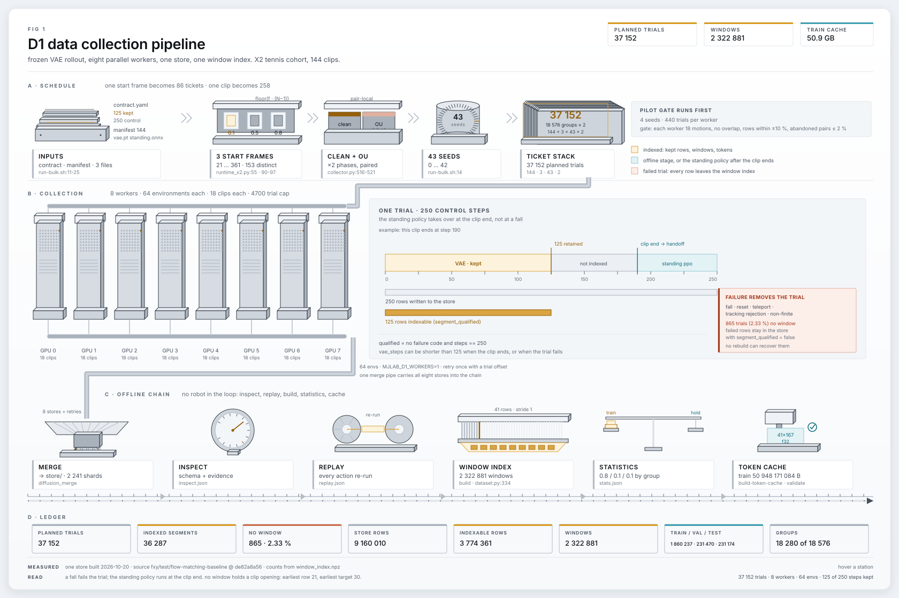

# X2 diffusion data collection: what the 144-clip dataset contains

Status: review note. First written 2026-10-29 12:10 (+08). Revised 2026-10-29
15:35 (+08) after an independent code review.
Owner: diffusion data workstream. Scope: the D1 collection procedure and the
built 144-clip dataset that trained the flow-matching arms.

This note describes the procedure and the stored data. It records numbers, not
plans. Section 8 corrects three statements that this workstream made earlier.

Revision 2 changes the mechanism in section 2 and revises findings 5, 6 and 7.
It does not change any measured count.



Figure 1 draws four bands: the schedule, the eight collectors with the trial
timeline, the offline chain, and the ledger. The source is
`build_pipeline_diagram.mjs` in this directory; run it again after a change to
any number in the figure.

## 1 Purpose

An operator asked whether the dataset holds data that starts at the first
reference frame of a clip. This note answers that question and records the rest
of the procedure, so that the operator can plan a schedule change against facts.

## 2 What produces the data

Three policy artifacts appear in this pipeline. They have different roles.

| Role | Artifact | When it acts |
|---|---|---|
| Tracking **teacher** | multi-motion PPO checkpoint `model_19999.pt` | Upstream only, during distillation |
| Tracking **student** | frozen VAE, `contract.vae_checkpoint` | During D1 collection, every clean step |
| **Standing** policy (`recovery_onnx`) | `x2-tennis-recovery-n25.onnx` | During D1 collection, after the reference clip ends |

The D1 rollout uses the VAE, and not the PPO teacher. `build_x2_runtime`
constructs `FrozenVaePolicy.from_checkpoint` for tracking and
`FrozenPpoRecoveryPolicy.from_onnx` for recovery, at
`runtime_x2.py:1320-1348`. The tracking teacher supplies one input only: its
ONNX metadata gives the action contract, and the code reads no policy weights
from it, at `runtime_x2.py:1224-1231`.

`FrozenVaePolicy.latent_and_action` computes one step as
`mu, _ = model.encode(reference)` and `action = model.decode(mu, conditioning)`
(`adapter.py:844-882`, encode and decode at lines 868 and 869). The reference
vector has 68 values, the conditioning vector has 99, and the 32-value `mu`
becomes the latent channel of the stored row.

The standing policy takes control at the **end of the reference clip**, not at a
fall. While the VAE tracks the reference it holds `controller: "vae"`. When the
reference ends, the collector hands the physical action to the standing policy
and continues to the 250-step budget (`collector.py:597-601`). The qualification
label for that trial is `vae_then_standing` (`qualification.py:626-628`). Those
later rows record `controller: "ppo"`.

A **physical fall does not hand over control**. It fails the trial
(`qualification.py:380-381`, `_fail("physical_fall")`) and the control loop
breaks at `collector.py:595-596`. A failed trial keeps its rows in the store,
but `_qualified_row_partition` sets no accepted row
(`collector.py:66-75`), so `_row_can_be_indexed` rejects every row of that trial
on `segment_qualified` (`dataset.py:139-153`). The `controller == "vae"` test at
`dataset.py:143` filters the post-clip-end `ppo` rows.

## 3 Trial schedule

| Item | Value |
|---|---|
| Clips | 144, from 213 to 453 frames, mean 317 |
| Start frames per clip | 3, at fractions 0.1, 0.5, 0.8 |
| Start frame formula | `floor(fraction x (N - 1))`, `runtime_x2.py:90-97` |
| Start frame values | 153 distinct values, from 21 to 361 |
| Seeds per start | 43, numbered 0 to 42 |
| Trial types | clean, and OU with `theta 0.8`, `sigma 0.1` |
| Planned groups | 18 576 |
| Indexed groups | 18 280 |
| Planned trials | 37 152 |
| Indexed segments | 36 287 (97.7 %) |
| Trials without a window | 865 (2.33 %) |
| Control steps per trial | 250 |
| Retained steps | 125 |
| Workers, environments | 8 processes, 64 environments each |
| Members per worker | 18 clips |

The OU noise applies to the clean action for the first 125 steps of an OU trial
(`collector.py:516-521`).

A trial runs for up to 250 control steps. While the reference clip is present the
VAE drives the robot. When the reference clip ends the standing policy takes over
and the trial continues to step 250. A fall, a reset, a teleport, a tracking
rejection or a non-finite step fails the trial and ends it early. A failed trial
does not enter the window index.

The qualification thresholds `retained_steps: 125` and `control_steps: 250` come
from `configs/diffusion/x2_50hz_collection_vgk36.yaml`. That file is
non-authorizing: it holds `execution_authorized: false`, `runtime_factory: null`
and a pilot block with `max_envs: 1`.

The schedule counts come from the launch driver,
`run-bulk.sh:11-14`: `N=8` worker processes, `PER=18` clips per worker, `ENVS=64`
environments per process, and `FULL_SEEDS=43`. The driver passes those values as
`--max-envs` and `MJLAB_D1_BULK_SEEDS`. The runtime default seed count is 57
(`runtime_x2.py:66`), so 43 comes from the driver and not from code or config.

## 4 Stored volume and splits

The index holds 2 322 881 windows.

| Split | Windows | Groups | Segments |
|---|---:|---:|---:|
| Train | 1 860 237 | 14 620 | 29 032 |
| Validation | 231 470 | 1 833 | 3 641 |
| Test | 231 174 | 1 827 | 3 614 |
| All | 2 322 881 | 18 280 | 36 287 |

The store holds 9 160 010 rows in 2 241 shards. A full trial writes 250 rows, so
`9 160 010 / 250 = 36 640` is a **lower bound** on the trial count, because a
failed trial writes fewer rows. That bound is about 512 below the 37 152 planned
trials.

Only 3 774 361 rows are indexable, which is the window count plus 40 rows for
each segment. The other 5 385 649 rows are stored but not indexable. Three cases
produce them: rows of a failed trial (`segment_qualified` false), `ppo` rows
after the reference ends, and the rows past `retained_steps` of an otherwise
qualified trial.

The split key is the group, and a group is `motion:seed:start_frame`. The
fractions are 0.8, 0.1 and 0.1 with seed 42 (`contract.py:141-142`). The split
unions groups that share a clean/OU pair identity or an initial-state identity
before it assigns them (`dataset.py:200-228`), so the assignment unit is the
union, not the single group.

The train token cache is 50 948 171 084 bytes with shape
`(1860237, 41, 167)` in float32. One token holds 135 state values and 32 latent
values.

## 5 Window layout

One window holds 41 rows. Rows 0 to 7 are history, row 8 is the current row,
and rows 9 to 40 are the predicted future (`contract.py:134-140`). The stride
is 1. A segment of length 125 frames yields 85 windows, and the index confirms
this count.

`ref_start` spans 0 to 84. Every segment contributes exactly one window at
`ref_start` 0, so 36 287 windows begin at the first recorded frame of a
segment. The shortest possible last band holds `N - floor(0.8 (N - 1)) = 44`
frames at `N = 213`, which is more than the 41 rows of one window, so the first
window of a segment cannot be blocked.

The index field `ref_length` is not a segment length. It is the fixed window
width, `length: int = 41` (`dataset.py:245`, saved at `dataset.py:879`). A
segment length has to be derived as `max(ref_start for that segment) + 41`, or
read from the store.

## 6 Reference-frame coverage

Coverage is the number of distinct clip frames that any window covers. I
computed it from `ref_start`, the segment length, and the clip length.

| Quantity | Value |
|---|---:|
| Reference frames in all clips | 45 653 |
| Frames covered | 39 924 (87.45 %) |
| Frames in the clip opening | 4 490 uncovered (9.84 %) |
| Frames in interior gaps | 1 239 uncovered (2.71 %) |
| Coverage per clip | 75.1 % to 89.7 %, median 88.5 % |
| First covered frame | 21 for the shortest clip, 45 for the longest |

Band _k_ covers its start frame `s_k` to `s_k + 124` when the trial survives.
Each clip has three bands. Band 3 starts at fraction 0.8, so it keeps about
0.2 x N frames, from 44 to 92 frames. The median band-3 length is 64 frames.

Band 1 always holds 125 frames, because `N - floor(0.1 (N - 1))` is at least 192
for the shortest clip. Band 2 holds 125 frames only when `N` is at least 248;
below that the clip end truncates it. Finding 6 counts 491 short band-2
segments.

Two interior gaps remain in a long clip. Clip `single_000` misses frames 170 to
225 and frames 351 to 360. Band 1 from frame 45 ends at 169, and band 2 from
frame 226 ends at 350, so the gaps start one frame after each band end.

The opening is 0.42 s to 0.90 s of each clip at 50 Hz. No window holds these
frames, as history or as a target.

## 7 Findings

1. The rollout policy is the frozen VAE. The PPO tracking teacher does not act
   during collection.
2. The dataset has no clip opening. The earliest reference frame in any window
   is 21, and the earliest predicted frame is 30.
3. The phase schedule causes the gap at the opening. The 8-frame history does
   not cause it, because a segment records its own history from step 0.
4. History dropout and the root mask change no coverage property, because both
   act on the training input and the loss, not on the index.
5. The index cannot measure survival, so it cannot rank clean against OU.
   23 664 of the 36 287 indexed segments (65.2 %) hold 125 qualified rows; the
   measured values are 65.3 % clean and 65.1 % OU. Every segment that falls
   short does so at a clip end, because any other short stop fails the trial and
   removes it from the index. These values are therefore a band composition, not
   a survival rate. The comparison is also confounded: an OU trial runs only
   when its clean partner qualified (`collector.py:337-345`).
6. All 12 623 short segments are clip-end truncations. 12 132 are band-3
   segments. The other 491 are band-2 segments with a median length of 117.
   No fall appears among them, because a fall removes the whole trial.
7. 865 of the 37 152 planned trials (2.33 %) produce no window. Two cases
   produce them. First, a trial ran and failed qualification; its rows are in the
   store with `segment_qualified` false. Second, the trial never ran; the
   collector blocks the OU partner of a failed clean trial
   (`collector.py:316-330`, `_admissible` at `collector.py:333-345`), so that OU
   trial has no rows. A recorded fall sets a failure at any step, not only
   inside the first 41 steps. I did not separate the two cases.
8. Validation is not motion-disjoint. A group separates a start frame and a
   seed, not a clip. The same clip appears in training, validation and test at
   different start frames. This is one reason why validation loss does not
   rank closed-loop survival.

## 8 Corrections to earlier statements

This workstream made three wrong statements about this collection. Item 1 was
made in conversation on 2026-10-29. Item 2 was written in revision 1 of this
note. Item 3 was made in conversation and repeated in revision 1. This section
records them, so that the record is not silent about them.

1. "One frozen PPO tracking policy plays each clip." The rollout policy is the
   frozen VAE. The PPO checkpoint acted only during distillation.
2. "After a physical fall the recovery policy takes control, so the trial
   reaches its full length." This note wrote that sentence in revision 1, and it
   is inverted. A fall fails the trial. The standing policy takes control at the
   end of the reference clip. That handoff is what carries a trial to 250 steps.
3. "A third of the trials stop early, because of a fall." All 12 623 short
   segments are clip-end truncation: 12 132 in band 3 and 491 in band 2. No
   measured segment stops early. A trial that stops early leaves the index, so
   the index reports 0 such segments. Revision 1 of this note called the 491
   band-2 clip-end segments an early-stop rate, which contradicts its own
   finding 6.

## 9 Limits

- I ran no new collection for this note. Every number comes from one store,
  built on 2026-10-20. I read the source at branch
  `fxy/test/flow-matching-baseline`, head `de82a8a56`.
- The coverage number assumes a band ends at its last indexed window. The store
  keeps the rows after a fall, and the index keeps them out by design.
- The 65.2 % value counts indexed segments that hold 125 rows. It is not a
  survival rate, because a failed trial leaves no segment.
- I did not separate the 865 unindexed trials into the never-ran case and the
  ran-and-failed case.
- I did not read `segment_qualified` per segment, so I did not measure the fail
  reason distribution.
- No approved ASD-STE100 word list is available in this environment, so I
  applied the sentence and voice rules but cannot claim word-level compliance.

## 10 Next actions

The operator asked for data at the opening. Three schedule changes give it.
Each start frame costs 86 trials per clip, which is 43 seeds times two
phases. The present data hold 37 152 trials and 3 774 361 indexable rows.

| Option | Change | Extra trials | Extra indexable rows | Share of present rows |
|---|---|---:|---:|---:|
| 1 | Add fraction 0.0 | 12 384 | 1 548 000 | 41 % |
| 2 | Add fractions 0.0, 0.05 and 0.95 | 37 152 | 3 310 484 | 88 % |
| 3 | Replace the fractions with a stride of 8 frames | 397 664 | 44 886 496 | 1 189 % |

I computed these values per clip from its length. A band adds `min(125, N -
start)` indexable rows. Option 3 has 35.1 starts per clip instead of 3.

The model gives 3 892 446 rows for the present schedule, which is 3.1 % above
the measured 3 774 361. Treat the extra rows as estimates against the measured
baseline.

Option 1 closes the opening and keeps the present bands. Option 3 closes every
gap, at about 12 times the present row count.

A new collection needs the full chain again: inspect, replay, merge, window
index, statistics, token cache. The present store cannot take extra trials
without a rebuild. Do not merge a partial store. The split assignment is a
permutation of the sorted group roots under `PCG64(42)`
(`dataset.py:212-214`), so any added group moves every group. The index load
then fails the `assignments_sha256` check (`dataset.py:916`). Option 3 also
replaces the present schedule, so its row count is a net figure: the stride-8
total is about 48.8 M rows, and `44 886 496` is that total minus the present
3.89 M. Read options 1 and 2 as additions and option 3 as a replacement.

The start frame 0 also needs a decision on one point. At frame 0 the reference
speed is near zero for a motion that begins at rest, so the first frames test
the model at a low speed that the present data rarely show. That is a data
change, and it needs a measurement, not an assumption.

## 11 Evidence

Index and store:

```text
/home/fushan/data/mjlab-144/data/offline/window_index.npz
/home/fushan/data/mjlab-144/data/store/            # 2 241 shards
```

Collection driver, remote copy and local copy:

```text
/home/fushan/mjlab-multimotion144-bulk-20261020/logs/diffusion/
  x2-multimotion144-preview-bulk-20261020/control/run-bulk.sh
logs/diagnostics/preview-flow-port-20261020/multimotion144-bulk/run-bulk.sh
```

Source read for this note:

```text
src/mjlab/tasks/tracking/diffusion/runtime_x2.py    lines 55, 66, 90-97, 1224-1348
src/mjlab/tasks/tracking/diffusion/adapter.py       lines 844-882
src/mjlab/tasks/tracking/diffusion/collector.py     lines 66-75, 316-345, 505-620
src/mjlab/tasks/tracking/diffusion/qualification.py lines 361-386, 601-635
src/mjlab/tasks/tracking/diffusion/dataset.py       lines 139-153, 200-245, 916
src/mjlab/tasks/tracking/diffusion/contract.py      lines 130-142
configs/diffusion/x2_50hz_collection_vgk36.yaml
```

Count commands used these index fields: `ref_start`, `ref_segment`,
`ref_split`, `ref_group`, `segment_ids`, `group_keys`. `ref_length` is in the
index but is always 41, so these counts do not use it. The
segment id carries the clip, seed, start frame and phase, for example
`x2-multimotion144-preview-bulk-20261020:single_000:13:226:clean:vae`. The store
metadata row carries `tick`, `reference_frame`, `controller` and
`terminal_evidence`.
